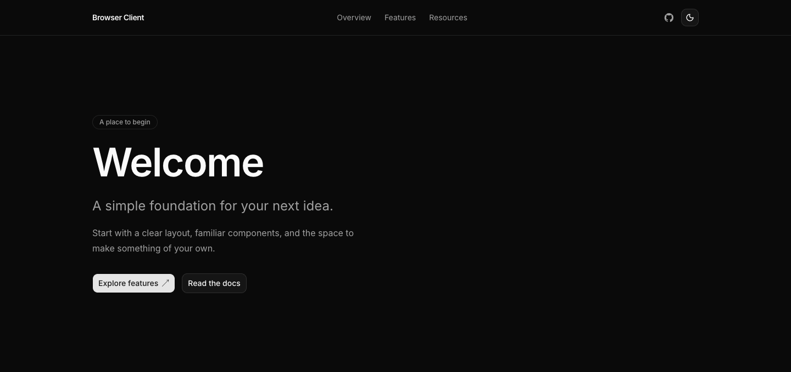
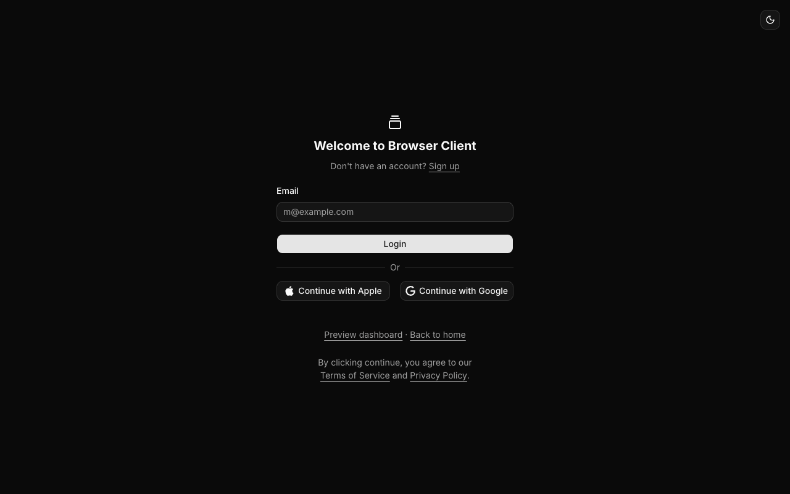
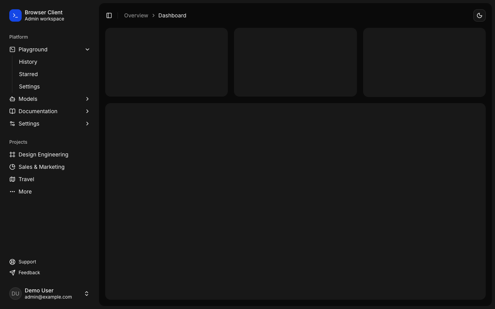
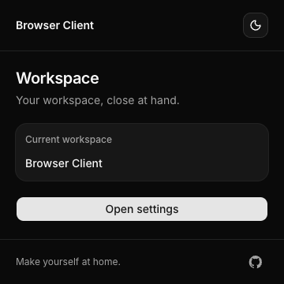
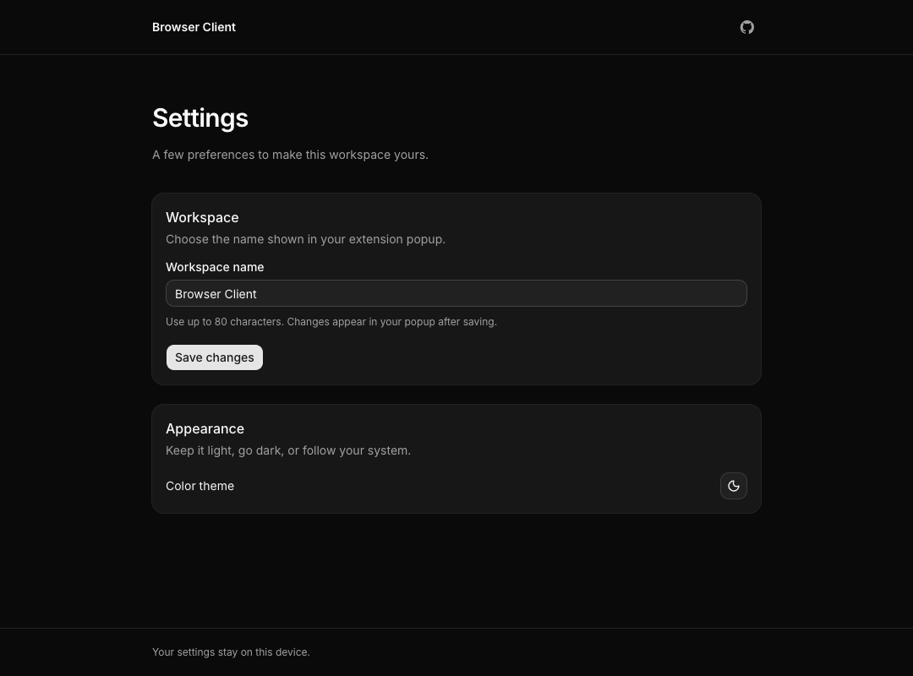

# Browser Client

**English** · [简体中文](README.zh-CN.md)

[](https://github.com/shell-echo/browser-client-monorepo/actions/workflows/ci.yml)
[](LICENSE)

A TypeScript monorepo starter for **Next.js web apps, React admin dashboards, and Chrome / Edge Manifest V3 extensions**. Build them together with shared shadcn/ui components, a permissioned extension communication SDK, and recoverable framework refreshes from official templates.

[Quick start](#quick-start) · [Previews](#previews) · [Extension SDK](#extension-sdk) · [Applications](#applications) · [Reinit](#reinit) · [Documentation](#documentation)

## Who this is for

- Build a website, an admin dashboard, and a browser extension in one pnpm / Turborepo workspace, with consistent UI and tooling.
- Connect your website to an installed extension through native Chrome Ports, with explicit page approval and Service Worker authorization.
- Keep business code while refreshing framework foundations, or compose multiple independent Web, Admin, and Extension instances from reusable seeds.

Start with the clients you need. Authentication, business APIs, production hosting, and store publication are integration work for your application.

## Included

- **Three applications:** a responsive web starter, Admin login / dashboard templates, and Chrome / Edge Manifest V3 popup / settings pages.
- **Shared UI:** shadcn preset **b0**, Base UI, bundled **Inter**, Lucide icons, and light / dark / system themes. UI text is English.
- **Shared tooling:** pnpm workspaces and catalogs, Turborepo, TypeScript presets, ESLint 10, Oxlint, Prettier, and VS Code settings.
- **Extension communication:** one dependency-free SDK for Web, popup, settings, and side panel; document-scoped grants, read-only website capabilities, subscriptions, and bounded reconnects.
- **Framework refreshes:** official Next.js / Vite scaffolds, compatible dependency solving, source preservation, and recoverable backups.
- **Validation:** production builds, browser interactions, responsive layouts, extension HMR / CSP, and checks before reinit replacement.
- **Delivery:** per-instance production ZIP packaging, deployment guidance, optional resource protection, and WCAG accessibility scans.

## Previews

### Web · Welcome

[](docs/images/web-dark.png)

### Admin · Login and dashboard

| Login · dark                                                                                     | Dashboard · dark                                                                                             |
| ------------------------------------------------------------------------------------------------ | ------------------------------------------------------------------------------------------------------------ |
| [](docs/images/admin-login.png) | [](docs/images/admin-dashboard.png) |

### Extension · Workspace and settings

<table>
  <tr>
    <th width="36%">Workspace popup</th>
    <th width="64%">Settings</th>
  </tr>
  <tr>
    <td valign="top" align="center"><a href="docs/images/extension-workspace.png"></a></td>
    <td valign="top"><a href="docs/images/extension-settings.png"></a></td>
  </tr>
</table>

All previews use dark mode. [See the full screenshot gallery and mobile layouts](docs/previews.md), including screenshot sources and capture sizes.

## Quick start

Use **Node.js 24 LTS** and **pnpm 11.25.0**, pinned in [the runtime configuration](.tool-versions) and [package manifest](package.json). With mise installed, run `mise install` to provision Node.

```sh
git clone https://github.com/shell-echo/browser-client-monorepo.git
cd browser-client-monorepo
pnpm install --frozen-lockfile
pnpm dev
```

Open Web at **http://127.0.0.1:3000** and Admin at **http://127.0.0.1:5173**. To use the extension, enable Developer mode in `chrome://extensions` or `edge://extensions` and load **`apps/extension/dist-dev`** as an unpacked extension.

For an ordinary browser preview of extension UI, stop the extension dev service and run `pnpm preview:extension`. Open **http://127.0.0.1:5174** for Workspace or **http://127.0.0.1:5174/options.html** for Settings. Preview preferences are separate from installed-extension preferences.

## Applications

| Application                 | Start individually       | Default URL / output                            | Included pages                                                         |
| --------------------------- | ------------------------ | ----------------------------------------------- | ---------------------------------------------------------------------- |
| [Web](apps/web)             | `pnpm dev:web`           | `http://127.0.0.1:3000`                         | Welcome, responsive navigation, feature cards, `/extension` connection |
| [Admin](apps/admin)         | `pnpm dev:admin`         | `http://127.0.0.1:5173`                         | Overview, `/login`, `/dashboard`, not-found and route recovery pages   |
| [Extension](apps/extension) | `pnpm dev:extension`     | Load `apps/extension/dist-dev`; dev port `5174` | Workspace popup, Settings, side panel, background service worker       |
| Extension UI preview        | `pnpm preview:extension` | `http://127.0.0.1:5174`                         | Ordinary browser preview of popup and settings                         |

`pnpm dev` starts Web, Admin, and the actual extension dev service. Extension development and UI preview share port `5174`; run one at a time. All development servers bind to localhost.

Admin is based on the official shadcn [login-05](https://ui.shadcn.com/blocks/login#login-05) and [sidebar-08](https://ui.shadcn.com/blocks/sidebar#sidebar-08) blocks. Its login actions are UI examples; authentication, protected routes, backend services, and production data must be connected by the application. Production Admin hosts need an SPA fallback for routes such as `/dashboard`.

The extension stores workspace preferences locally, synchronizes popup / settings changes, and handles read / write failures. Production output is **`apps/extension/dist`**; unified communication uses `storage`, `activeTab`, `scripting`, and `sidePanel`, with an explicit website allowlist, an isolated content agent, and strict CSP. See [communication and authorization](docs/extension-communication.md) and [development and production setup](docs/development.md#browser-extension).

## Extension SDK

`@browser-client/extension-sdk` connects Web, popup, options, and side panel through native Chrome Ports. The extension Service Worker validates sender identity, routes requests, and grants access to a specific origin, tab, and document. An isolated content agent handles approved page reads.

To try it, load the extension, open the Web app's `/extension` page, enter its Extension ID, request access, and approve that page in the extension's **Connections** UI. The Web example can read the workspace name and explicitly request its own selected text. Navigation or revocation ends that grant.

Production origins and custom ports need an explicit allowlist entry and an extension rebuild. Websites receive read-only capabilities; arbitrary script execution, network proxies, screenshots, and downloads are outside this version. [Setup, SDK examples, permissions, and traffic limits](docs/extension-communication.md).

## Composable applications

Keep only Admin, add multiple Web/Admin instances, or retain the default three clients. Instance names and template types are independent. [Application registry, lifecycle and recovery](docs/applications.md).

```sh
pnpm app list
pnpm app add portal --type web --port 3001        # Preview only
pnpm app add portal --type web --port 3001 --apply
pnpm app dev portal
pnpm app remove extension                     # Preview only
```

## Reinit

Refresh selected applications from official templates while retaining application code and the shared design system.

```sh
pnpm reinit                     # Preview only; no network access or file writes
pnpm reinit web --dry-run        # Preview a single application
pnpm reinit --apply              # Rebuild all applications and update managed dependencies
pnpm reinit admin --apply        # Rebuild Admin; validate every application
pnpm reinit --apply --offline    # Replay recorded, cached versions
```

| Preserved                                                                                | Rebuilt / updated                                                                        |
| ---------------------------------------------------------------------------------------- | ---------------------------------------------------------------------------------------- |
| Business source, public assets, environment files, HTML entries, and extension manifest  | Official template foundations, application framework configuration, and standard scripts |
| Shared shadcn/ui, b0 preset, Inter, theme components, editor settings, and documentation | Managed dependency manifests, catalogs, lockfile, and version receipts                   |

Online rebuilds require the latest stable Next.js / Vite / CRXJS for the selected targets and choose the highest compatible stable shared dependencies. **ESLint cannot fall below 10**, including offline replay. Offline mode uses recorded versions and caches; it does not query current releases.

Stop development / build processes and pause editing before `--apply`. Reinit validates strict peer compatibility, builds, and every registered instance's browser assertions before replacement. Validation failures preserve or restore the original project; unconfirmed process termination retains the lock and recovery state. Never remove a lock blindly.

[Workflow and dependency policy](docs/reinit.md) · [Failure recovery and backups](docs/reinit.md#failure-recovery-and-backups) · [Cleanup and retention](docs/reinit.md#cleaning-old-successful-workspaces)

## Workspace

```text
apps/
  web/                  Next.js App Router
  admin/                Vite + React + React Router
  extension/            Vite + React + CRXJS / Manifest V3
packages/
  ui/                   Shared shadcn/ui, bundled fonts, and themes
  extension-sdk/        Runtime-validated protocol, clients, and authorization broker
  typescript-config/    TypeScript presets
  eslint-config/        Shared ESLint rules
  oxlint-config/        Shared Oxlint rules
scripts/                Reinit, dependency policies, tests, and browser verification
docs/                   Guides and screenshots
browser-tests.config.mts  Application browser assertions and HMR hooks
template-versions.json    Generator versions and dependency receipts
```

## Development commands

Run commands from the repository root. The single `pnpm-lock.yaml` and workspace catalogs keep shared dependencies consistent.

| Command                             | Purpose                                                                                 |
| ----------------------------------- | --------------------------------------------------------------------------------------- |
| `pnpm ui:add dialog`                | Add a shadcn primitive to the shared UI package                                         |
| `pnpm format` / `pnpm format:check` | Format or check source and documentation                                                |
| `pnpm lint` / `pnpm typecheck`      | Check all workspaces                                                                    |
| `pnpm typecheck:scripts`            | Strictly check engineering scripts, regression tests, and browser assertions            |
| `pnpm check`                        | Formatting, compatibility, unit tests, lint, types, builds, and extension output checks |
| `pnpm test:browser`                 | Sequential acceptance of every registered instance with strict coverage aggregation     |
| `pnpm test:web-admin`               | Production browser checks for Web and Admin                                             |
| `pnpm test:extension`               | Actual extension loading, settings, themes, HMR, production build, and UI preview       |
| `pnpm verify:low --guard check`     | Wait for CPU/memory headroom and monitor owned verification processes                   |
| `pnpm test:accessibility`           | Check the real accessibility engine using valid and deliberately invalid pages          |
| `pnpm extension:package <id>`       | Validate a built Extension and create a private production ZIP and receipt              |
| `pnpm test:reinit`                  | Slower real online / offline rebuild acceptance in an isolated copy                     |
| `pnpm audit:security`               | Audit locked dependencies and verify the local security patch                           |

Before the first browser test, run `pnpm exec playwright install chromium`; Linux CI also installs browser system dependencies. `pnpm check` does not launch browsers. [Test coverage, setup, and reports](docs/testing.md).

## Documentation

| Guide                                                      | Contents                                                                                      |
| ---------------------------------------------------------- | --------------------------------------------------------------------------------------------- |
| [Development](docs/development.md)                         | Templates, shared configuration, shadcn/ui, themes, editor setup, and extension workflow      |
| [Application lifecycle](docs/applications.md)              | Registry, instance identity, adding, removing, restoring, and composing clients               |
| [Extension communication](docs/extension-communication.md) | SDK usage, exact-origin trust, page approval, routing, recovery, and traffic limits           |
| [Reinit and upgrades](docs/reinit.md)                      | Preservation contract, compatible dependencies, offline mode, timeouts, recovery, and cleanup |
| [Testing and CI](docs/testing.md)                          | Browser assertions, regression suites, real reinit acceptance, reports, and workflows         |
| [Deployment and delivery](docs/deployment.md)              | Web hosting, Admin routing, environment inputs and per-instance Extension ZIPs                |
| [Dependency security](docs/security.md)                    | Audits, the current patch, and scheduled checks                                               |
| [Screenshot gallery](docs/previews.md)                     | Dark / mobile previews and screenshot capture notes                                           |

Every guide is also available in [Simplified Chinese](docs/zh-CN/README.md). Keep each page in one language and update both versions when commands or behavior change. Product UI labels and code identifiers retain their original spelling.

## Contributing

Keep application features in their application and reusable primitives in `packages/ui`. Update `browser-tests.config.mts` when replacing starter screens, and put persistent framework customizations in the reinit integration adapters.

Run `pnpm check` and the affected browser suites before proposing changes. Update documentation and screenshots when behavior or starter UI changes. [Development conventions and configuration](docs/development.md).

## License

[MIT](LICENSE).
