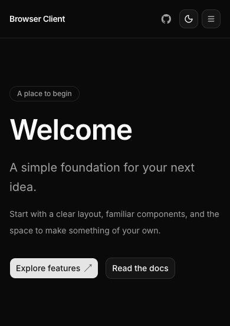
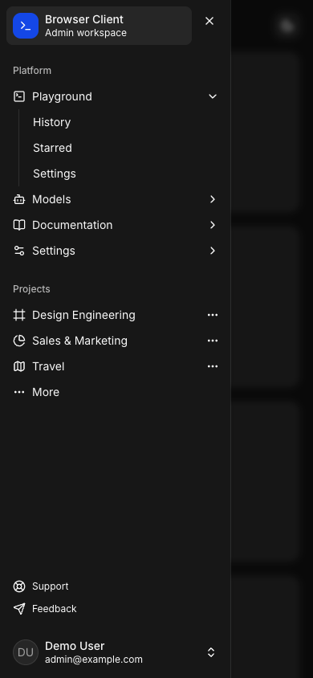

# 截图库

[English](../previews.md) · [中文文档](README.md) · [项目首页](../../README.zh-CN.md) · [开发](development.md) · [框架更新](reinit.md) · [测试](testing.md)

这些截图展示起始界面的暗色主题，使用共享 b0 预设和本地 Inter 字体。点击图片可查看原始尺寸；截图对应下方注明的源码版本。

## 网站

### 首页：桌面端

### 首页：移动端

## 管理后台

### 登录页

### 仪表盘

空面板用于后续业务内容，登录操作只演示界面行为，未接入认证。

### 移动端导航

## 扩展

### 工作区弹出页

### 设置页

## 截图说明

界面源码版本：[59848fe](https://github.com/shell-echo/browser-client-monorepo/commit/59848fefd051e480fd0e3d323758fbafc0803288)。

截图来自经过验证的生产构建，使用 Playwright Chromium、全新浏览器配置、本地字体和减少动画设置。扩展截图来自加载了真实 Service Worker 与存储的未打包生产扩展，没有使用普通网页预览。

| 文件                      | 尺寸       | 主题 | 内容                              |
| ------------------------- | ---------- | ---- | --------------------------------- |
| `web-dark.png`            | 1440 × 679 | 暗色 | 网站导航与完整概览区              |
| `web-mobile.png`          | 390 × 553  | 暗色 | 移动端导航与完整概览区            |
| `admin-login.png`         | 1280 × 800 | 暗色 | 后台 `/login`                     |
| `admin-dashboard.png`     | 1280 × 800 | 暗色 | 后台 `/dashboard`                 |
| `admin-mobile.png`        | 390 × 844  | 暗色 | 后台仪表盘及展开的移动端侧栏      |
| `extension-workspace.png` | 360 × 360  | 暗色 | 扩展 `index.html`，裁剪至弹出容器 |
| `extension-settings.png`  | 1080 × 800 | 暗色 | 扩展 `options.html`               |

界面变化后更新图库：

1. 对新源码运行相关[浏览器验收](testing.md)。
2. 在隔离浏览器配置中打开生产页面，等待 Inter 加载和过渡结束。
3. 所有预览选择暗色，登录框留空，扩展使用默认工作区设置；画面不包含浏览器工具栏、私有数据或测试故障状态。
4. 替换 `docs/images/`，按原尺寸检查，同时更新中英文尺寸表和源码版本。

网站截图结束于概览区边界，扩展弹出页结束于容器边界，其他图片显示表中完整视口。没有为文档修改应用颜色、内容或布局。
